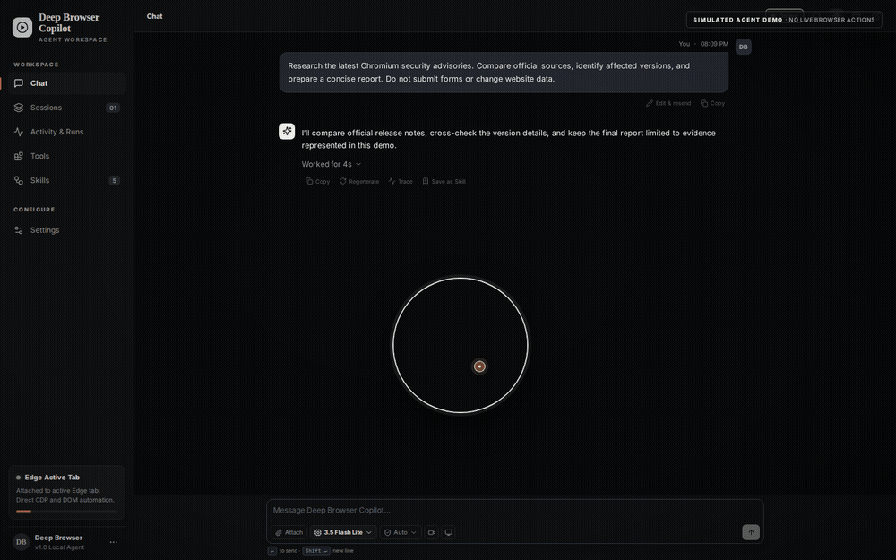
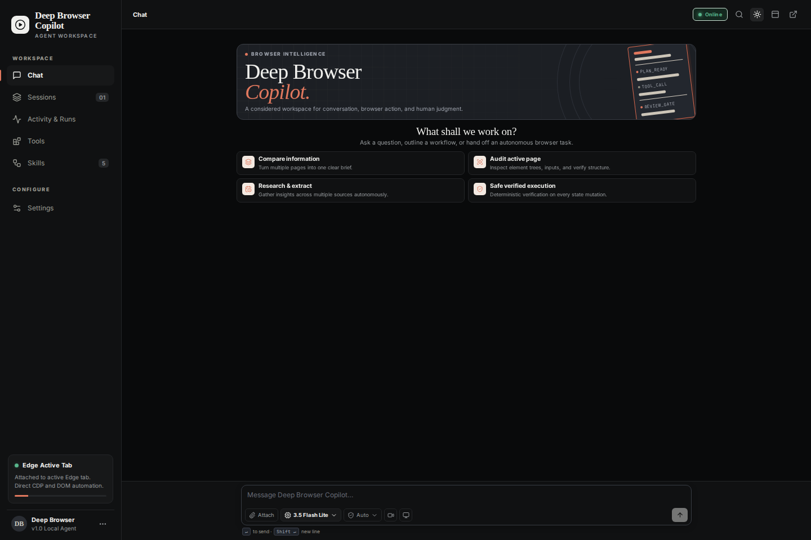
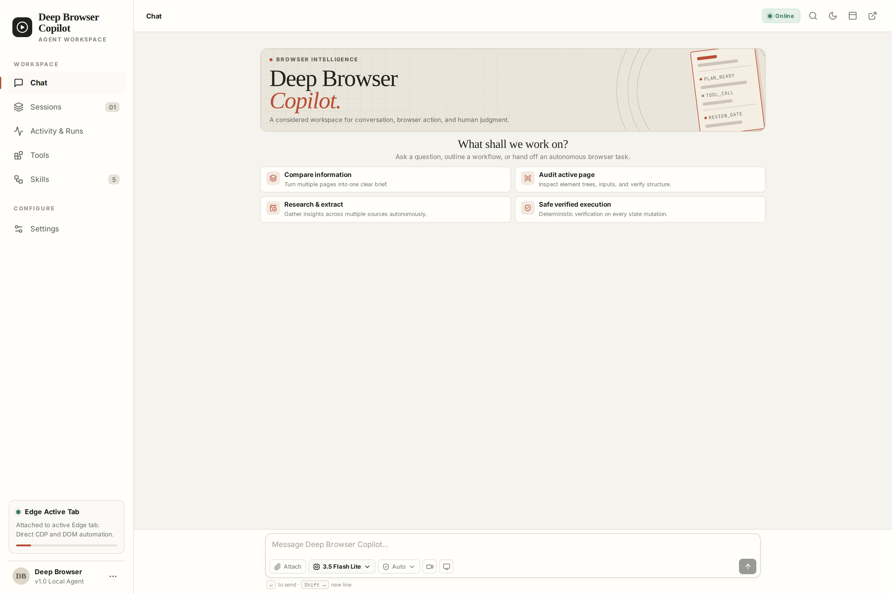
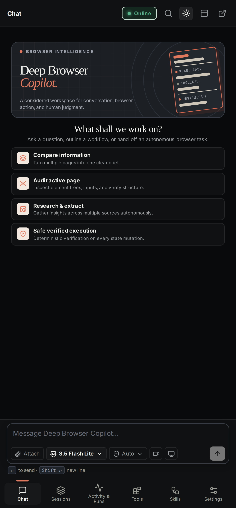

# Deep-Browser

<p align="center">
  <strong>AI browser copilot for desktop and Chrome.</strong><br>
  Delegate multi-step web tasks in natural language, inspect agent activity, and keep sensitive actions under human control.
  <br><br>
  
  
  
</p>

## Agent demo

<p align="center">
  
  <br>
  <sub>Simulated showcase only — prompt, reasoning, tool results, and verification data are demo fixtures, not a live browser run.</sub>
</p>

## Interface

| **Dark theme** | **White theme** |
|:---:|:---:|
|  |  |

**Chrome Side Panel · High-resolution capture**

<p align="center">
  
</p>

## Features

- **Natural-language tasks** — delegate multi-step browser workflows through chat.
- **Execution visibility** — inspect reasoning display, tool calls, event logs, and verification status.
- **Human approval** — keep sensitive actions behind explicit review gates.
- **Desktop + Chrome** — Electron workstation and Chrome Manifest V3 side panel.
- **Model configuration** — Gemini by default, with optional OpenAI, Anthropic, and Ollama settings.

## Tech stack

**Agent runtime:** Python · Browser Use · FastAPI · WebSockets  
**Desktop:** Electron · React · TypeScript · SQLite  
**Extension:** Chrome Manifest V3 · React · TypeScript

## Quick start

### 1. Configure the API key and start the local bridge

Requires Python 3.11+ and a Google Gemini API key.

```bash
git clone https://github.com/Fadhlijeu/deep-browser.git
cd deep-browser
cp .env.example .env
# Add your key as GOOGLE_API_KEY in .env

python -m venv .venv
# Linux/macOS:
source .venv/bin/activate
# Windows PowerShell: .venv\Scripts\Activate.ps1

python -m pip install -e .
uvicorn deep_browser.bridge.server:app --host 127.0.0.1 --port 8765
```

### 2. Build and load the Chrome extension

```bash
npm ci --prefix extension
npm run build --prefix extension
```

Open `chrome://extensions`, enable **Developer mode**, select **Load unpacked**, and choose the `extension/` folder.

### 3. Run the desktop app (optional)

Requires Node.js 20+.

```bash
npm install --prefix app --legacy-peer-deps
npm run dev --prefix app
```

Browser control runs locally; prompts are sent to the configured AI provider. Avoid entering sensitive information into untrusted websites.

## License

MIT — see [LICENSE](LICENSE). Third-party licenses and upstream attribution are documented in [THIRD_PARTY_NOTICES.md](THIRD_PARTY_NOTICES.md).
