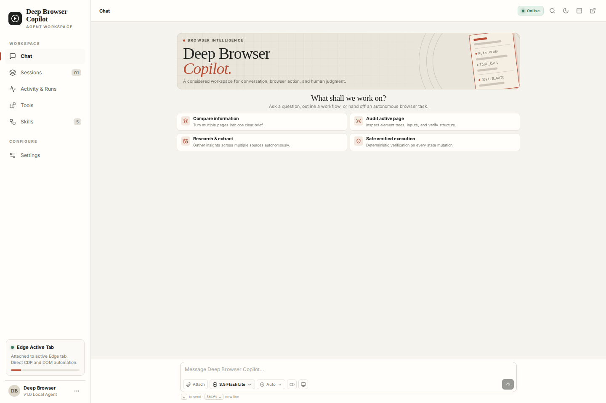

# Deep-Browser

**An AI-powered browser agent for desktop and Chrome.** Delegate multi-step web tasks in natural language, follow execution in real time, and keep sensitive actions behind human confirmation.

## Interface



## Features

- **Chrome Copilot** — chat-based task control, execution timeline, event logs, and verification status.
- **Human-in-the-loop safety** — configurable approval gates for sensitive browser actions.
- **Desktop workstation** — Electron/React UI, isolated browser sessions, and persistent session history.
- **Local agent bridge** — connects the Chrome extension to the Browser Use runtime over HTTP and WebSockets.
- **Flexible model setup** — Gemini is the default; optional provider settings include OpenAI, Anthropic, and Ollama.

## Tech stack

- **Agent runtime:** Python, Browser Use, FastAPI, WebSockets
- **Desktop:** Electron, React, TypeScript, SQLite
- **Extension:** Chrome Manifest V3, React, TypeScript

## Quick start

### 1. Configure the API key and start the bridge

Requires Python 3.11+ and a Google Gemini API key.

```bash
git clone https://github.com/Fadhlijeu/deep-browser.git
cd deep-browser
cp .env.example .env
# Add your key as GOOGLE_API_KEY in .env
python -m pip install -e .
uvicorn deep_browser.bridge.server:app --host 127.0.0.1 --port 8765
```

### 2. Build the Chrome extension

In a second terminal, from the repository root:

```bash
npm ci --prefix extension
npm run build --prefix extension
```

Open `chrome://extensions`, enable **Developer mode**, choose **Load unpacked**, and select the `extension/` folder.

### 3. Run the desktop app (optional)

Requires Node.js 20+.

```bash
npm install --prefix app --legacy-peer-deps
npm run dev --prefix app
```

> Browser control runs locally; prompts are sent to the configured AI provider. Avoid entering sensitive information into untrusted websites.

## License

MIT — see [LICENSE](LICENSE). Third-party licenses and upstream attribution are listed in [THIRD_PARTY_NOTICES.md](THIRD_PARTY_NOTICES.md).
