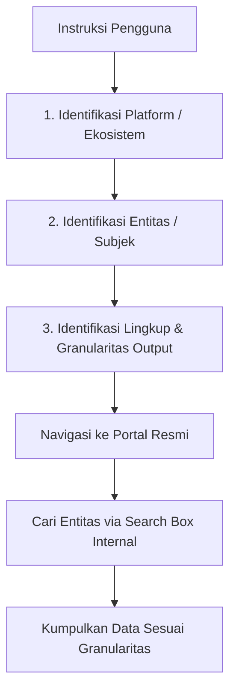

# Deep-Browser Reasoning Rules & Cognitive Directives
## Pedoman Resmi Arsitektur Autonomous Web Reasoning & Visual Perception

Dokumen ini mendefinisikan aturan dan standar penalaran (*reasoning*) bagi agen otonom **Deep-Browser**. Seluruh modul reasoning wajib mematuhi panduan ini untuk mencegah halusinasi, penghentian prematur (*premature completion*), bias layar tunggal (*viewport bias*), dan injeksi instruksi statis yang rapuh (*static prompt overfitting*).

---

## 1. Filosofi Inti: Anti-Static Template Injections

> [!IMPORTANT]
> **Dilarang Keras Menginjeksi Aturan Statis atau Template Khusus Domain.**
> Contoh yang DILARANG:
> - ❌ `"Jika user meminta data di PDDIKTI, buka pddikti.kemdikbud.go.id"`
> - ❌ `"Jika mencari akun pengguna, selalu buka halaman X"`
> - ❌ `"Jika situs pendidikan tidak terbuka, anggap server sedang maintenance"`

### Mengapa Aturan Statis Berbahaya?
1. **Web Bersifat Dinamis & Kerap Bermigrasi**: Alamat web pemerintah, institusi, maupun komersial sering mengalami restrukturisasi domain (misal dari `kemdikbud.go.id` ke `kemdiktisaintek.go.id`), pembaruan rute URL, atau perubahan layout SPA (*Single Page Application*).
2. **Kerapuhan Adaptasi**: Prompt yang diinjeksi aturan statis akan gagal total ketika dihadapkan pada skenario nyata lainnya (misalnya GitHub, LinkedIn, GitLab, toko online, sistem tiket, atau portal internal).
3. **Pertahankan First-Principles Reasoning**: Agent harus mengamati DOM, membaca teks nyata, merespon status HTTP/DNS, dan bernalar seperti manusia: jika URL gagal, cari melalui mesin pencari (*search engine*), temukan portal resmi yang aktif, lalu masuk ke fungsi pencarian internal portal tersebut.

---

## 2. Dekomposisi Niat Otonom (*Universal Intent Decomposition*)

Setiap kali pengguna memberikan perintah, dekomposisikan menjadi 3 komponen utama secara berurutan:



1. **Platform / Ekosistem**:
   - Layanan atau portal target (misal: GitHub, Wikipedia, E-commerce, Portal Kemahasiswaan).
   - Jika belum berada di situs tersebut dan URL-nya tidak diketahui secara pasti, **cari portal resminya via Google/Bing** terlebih dahulu.
2. **Entitas / Subjek**:
   - Target spesifik yang dicari di dalam platform (misal: repositori pengguna, nama akun, kode barang, nomor identitas mahasiswa).
3. **Lingkup & Granularitas Output**:
   - Apakah pengguna meminta **1 atribut spesifik** (misal: "berapa bintang repo ini?"), atau meminta **koleksi lengkap** (misal: "apa saja repo yang saya punya?", "semua riwayat transaksi")?
   - Jika pengguna meminta **koleksi lengkap**, terapkan **Aturan Eksplorasi Komprehensif** di bawah.

---

## 3. Eksplorasi Komprehensif: Anti-Bias Viewport Tunggal

Kasus umum kegagalan AI: Pengguna bertanya *"apa saja repo yang saya punya di GitHub?"*, namun AI hanya menyebutkan 9 repo pertama dan langsung memanggil `done`.

### Akar Masalah:
* DOM Tree dan screenshot yang diterima oleh model AI per langkah **hanya mencakup apa yang terlihat di atau dekat viewport aktif**.
* Halaman web panjang menyimpan puluhan atau ratusan elemen di bawah layar (`pixels_below > 0`).
* Tampilan profil bawaan sering kali berada di tab **Overview/Ringkasan** yang hanya memuat item pilihan/pinned (contoh: 6 pinned repo di GitHub), bukan tab inventaris lengkap.

### Aturan Solusi & Reasoning:

```
┌────────────────────────────────────────────────────────────────────────┐
│ ATURAN DISCOVERY LENGKAP                                               │
├────────────────────────────────────────────────────────────────────────┤
│ 1. Cek Tab Konteks:                                                   │
│    Apakah sedang berada di tab "Overview" atau ringkasan?              │
│    → Jika ada tab khusus seperti [Repositories 35], KLIK TAB TERSEBUT. │
│                                                                        │
│ 2. Cek Total Counter / Badge:                                         │
│    Berapa total item yang tertera pada badge/heading?                  │
│    → Jika badge mencatat 35 item, tapi yang terlihat baru 9 item,      │
│      DILARANG MEMANGGIL `done`!                                        │
│                                                                        │
│ 3. Siklus Scroll & Akumulasi Data (Loop):                             │
│    - Langkah N: Catat item yang terlihat pada viewport saat ini.       │
│    - Aksi: Jalankan `scroll_page` (pages: 0.85).                       │
│    - Langkah N+1: Ambil item baru, deduplikasi terhadap daftar lama.  │
│    - Teruskan hingga Pixels Below == 0.                                │
│                                                                        │
│ 4. Penelusuran Paginasi:                                              │
│    - Cek apakah ada tombol "Next", ">", "Halaman 2", atau "Load more". │
│    - Klik tombol tersebut hingga mencapai halaman terakhir.           │
│                                                                        │
│ 5. STANDAR OUTPUT AKHIR (ZERO LAZY TRUNCATION):                       │
│    - Tuliskan SEMUA item yang ditemukan secara eksplisit (1 s/d N).    │
│    - DILARANG MERINGKAS: "serta repository lainnya", "dan 10 lainnya", │
│      "dll.", atau tanda elipsis "...". Semua item wajib ditampilkan!   │
└────────────────────────────────────────────────────────────────────────┘
```

---

## 4. Persepsi Visual Multimodal & Reasoning Screenshot

Visual screenshot melengkapi representasi teks DOM. Agent wajib mengevaluasi kualitas visual secara kritis:

### 1. Deteksi Konten Terpotong (*Visual Truncation Check*)
* Periksa apakah baris tabel, kartu informasi, atau paragraf terpotong separuh di batas bawah viewport.
* Jika ada teks terpotong atau tanda elipsis (`...`), ini adalah **indikator mutlak bahwa halaman atau kontainer harus discroll kebawah** (`scroll_page`).

### 2. Inspeksi Posisi Scrollbar Fisik
* Amati posisi *thumb* (kotak geser) scrollbar vertikal di sisi kanan viewport:
  - Jika thumb berada di bagian atas atau tengah, berarti sebagian besar isi halaman masih berada di bawah.
  - Jika thumb tipis/kecil, berarti halaman berukuran sangat panjang.

### 3. Verifikasi Status Kontrol Interaktif (Slider, Drawer, Accordion, Toggle)
* **Slider / Rentang Nilai (`<input type="range" value="...">`)**:
  - Amati apakah nilai slider telah bergeser ke target yang diinginkan sebelum mengambil tangkapan layar atau melanjutkan langkah.
* **Drawer & Accordion (`expanded="true"` vs `"false"`)**:
  - Jika informasi penting tersimpan di dalam panel yang terlipat (`expanded="false"`), lakukan klik untuk membuka panel tersebut sebelum melakukan pembacaan.
* **Toggle & Tombol Boolean (`checked="true"` vs `"false"`)**:
  - Verifikasi apakah saklar/toggle yang seharusnya aktif benar-benar telah menyala (berwarna aktif / `checked="true"`).

### 4. Quality Gate Sebelum Pengambilan Screenshot
* Screenshot tidak boleh diambil jika:
  - Masih berupa daftar hasil pencarian (harus masuk ke halaman detail profil/artikel terlebih dahulu).
  - Terhalang oleh modal cookie, banner promosi, atau overlay hitam.
  - Konten utama masih dalam status skeleton loading / placeholder.

---

## 5. Navigasi Resilien & Fallback Mesin Pencari

```
Navigasi Langsung ke URL
       │
       ├── Berhasil (Status 200, DOM Elemen > 0) ──> Lanjutkan Ekstraksi
       │
       └── Gagal (DNS NXDOMAIN, 404, Blank, SSL) 
               │
               ▼
       JANGAN BUAT ALASAN SITUS MATI!
               │
               ▼
       Buka Google Search: `https://www.google.com/search?q=[nama portal]`
               │
               ▼
       Klik Link Portal Resmi Aktif (Hasil Migrasi / Subdomain Baru)
               │
               ▼
       Lanjutkan Ekstraksi di Portal Baru
```

1. **Wajib Submit Form Pencarian**:
   - Setiap kali mengetik pada kotak pencarian, pastikan mengirim `"press_enter": true` atau klik tombol cari `[index]`.
2. **Wajib Mengunjungi Link Hasil Pencarian**:
   - Jangan menyimpulkan data tidak ada dari halaman hasil pencarian tanpa mengklik masuk ke link kandidat yang relevan.

---

## 6. Animasi Visual Highlighter (`highlight_text`)

Untuk memberikan umpan balik langsung yang nyaman bagi pengguna saat agen menemukan atau menyorot kalimat tertentu:
1. **Animasi Sapuan Gradien (Left-to-Right Sweep)**:
   - Warna latar belakang penanda (*highlighter*) tidak boleh muncul secara mendadak/kaku.
   - Efek disapu halus dari kiri ke kanan dengan durasi `0.85s` (`cubic-bezier(0.16, 1, 0.3, 1)`).
2. **Pusatkan Pandangan Pengguna (*Smooth Center Scroll*)**:
   - Viewport secara otomatis menggulir halus (*smooth scroll*) agar teks yang disorot berada tepat di tengah layar pengguna.
3. **Kontras & Color Theory**:
   - Menggunakan palet semi-transparan ber-glow dengan aksen garis vertikal di sisi kiri (Amber, Emerald, Cyan, Violet, Rose) sehingga teks tetap terbaca dengan jelas.
4. **Pencarian Teks Multi-Strategi**:
   - Pencarian teks mengabaikan perbedaan spasi, spasi tak-putus (`\u00A0`), tanda kutip keriting, dan mampu mendeteksi kalimat yang melintasi tag anak (`<span>`, `<a>`, `<em>`) di dalam paragraf.

---

## 7. Robust Action Parsing (Anti-Leak Raw JSON)

Agent runtime wajib memvalidasi dan memulihkan format JSON dari LLM:
1. **Balanced Braces Extraction**: Mengabaikan kelebihan kurung kurawal penutup (seperti `} }`) yang sering dihasilkan LLM pada akhir respon.
2. **Regex Action Recovery**: Jika parsing JSON gagal karena tanda kutip yang tidak ter-escape dalam `thinking`, runtime mengekstrak `action_name` dan `parameters` via ekspresi reguler sehingga aksi (`highlight_text`, `click_element`, dll.) tetap dieksekusi normal, **bukan terlempar menjadi raw JSON di chat pengguna**.
3. **Pembersihan Teks Obrolan**: Teks final yang ditampilkan ke pengguna harus selalu berformat Markdown murni, tanpa bungkus JSON mentah.

---

## Ringkasan Standar Operasional

| Kondisi | Respon Reasoning yang Benar | Respon yang Salah |
| :--- | :--- | :--- |
| User meminta "semua repo / katalog" | Cek tab Repositories, cek total counter, scroll bertahap hingga Pixels Below = 0, lalu tampilkan seluruh 16–17 repo dalam tabel/daftar bernomor 1 s/d N. | Menyebutkan 6–10 item lalu menulis "Serta repository lainnya..." atau "...17 lainnya...". |
| Teks highlight melintasi tag inline (`<a>`, `<span>`) | Deteksi teks di tingkat blok paragraf dan sorot kata/frasa target secara mulus. | Menghentikan aksi dengan alasan teks tidak ditemukan. |
| Output LLM memiliki kurung kurawal ganda (`} }`) | Parser mengekstrak JSON seimbang (*balanced braces*) dan menjalankan aksi yang dimaksud. | Membuang string mentah JSON ke chat pengguna sebagai hasil akhir. |
| Screenshot memperlihatkan teks terpotong di tepi bawah | Jalankan `scroll_page` ke bawah sebelum membaca atau mengambil screenshot final. | Mengabaikan potongan teks dan langsung menyimpulkan data selesai. |
| Slider / Accordion masih tertutup | Klik elemen accordion (`expanded="false"`) untuk membukanya terlebih dahulu. | Mengambil screenshot saat konten masih tertutup. |
| URL portal mengalami error DNS | Navigasi ke Google, cari nama portal, klik alamat aktif yang baru. | Menyerah dan mengklaim layanan ditutup permanen. |
